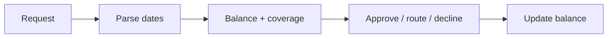

# Leave Request Approval Bot

> Checks balance, team coverage and blackout dates, then auto-approves the easy ones and routes the rest.

     

**Sector:** HR & Operations  ·  **Project 20 of 50** in my [AI Automation Projects series](https://github.com/Princewill106/Princewill106)

## The problem

Leave requests arrive over WhatsApp, email and hallway conversations. Managers approve without checking balances or who else is away, and then discover half the team is off during month-end close.

## How it works



1. **Parse** — Free-text requests are parsed for start and end dates and leave type.
2. **Count** — Working days are counted, excluding weekends and public holidays from `config.json`.
3. **Check** — Leave balance, blackout dates and minimum staff per team are checked against approved leave.
4. **Decide** — Clean requests are auto-approved, coverage conflicts route to the manager, and over-balance or blackout requests are declined with a reason.
5. **Update** — Approved days are deducted and the calendar updated in `output/`.

## Features

- Natural-language date parsing ('20th to 24th Oct')
- Public holiday and weekend exclusion
- Team coverage rule
- Blackout periods
- Auto-approval with audit trail

## Quick start

```bash
git clone https://github.com/Princewill106/leave-request-approval-bot.git
cd leave-request-approval-bot
python main.py --demo
```

No installs needed: it uses only the Python standard library. The demo runs fully offline using the sample data in this repo.

**Optional: plug in an LLM.** Copy `.env.example` to `.env` and add an Anthropic or OpenAI key. The project will then use the model for the language-heavy steps and fall back to its rule-based logic if a call fails.

Run the tests:

```bash
python -m unittest -v
```

## Sample output

```text
Amaka    "Hi, I'd like to be off from 12th to 16th October please"
         -> APPROVED: 5 working days; balance after: 7

Bayo     "Leave 19th - 23rd Oct for a family wedding"
         -> DECLINE: needs 5 days but balance is 3

Dupe     "Can I take 29th to 30th Oct?"
         -> DECLINE: overlaps blackout: Month-end close

Amaka    "Also off 21st to 22nd Oct"
         -> ROUTE TO MANAGER: Support would be below minimum cover on Wed 21 Oct

Efe      "Need some days off soon"
         -> CLARIFY: couldn't read the dates; please use e.g. '20 Oct to 24 Oct'

Balances: {'Amaka': 7, 'Bayo': 3, 'Chinedu': 10, 'Dupe': 15, 'Efe': 8}
```

## Use it in n8n (no code needed)

[`n8n-workflow.json`](n8n-workflow.json) is a ready-to-import n8n version of this project, built for n8n 1.x.

1. In n8n, open **Workflows → Import from File** and choose `n8n-workflow.json`.
2. Click **Test workflow**. It runs the full logic on the sample data built into the *Sample data* node, so you can see the results before connecting anything.
3. Open each output node and connect your accounts: Google Sheets (OAuth2), Slack. For Google Sheets, pick your spreadsheet and sheet.
4. Adjust the settings at the top of the **Logic** node (thresholds, templates, contacts), then **Activate**.

**Flow:** **n8n Form** → **Logic** (Code node) → **Route** (Switch)

**Outputs:**
- Record approved leave
- Tell employee (declined)
- Ask manager to decide
- Ask employee for dates

The Logic node is a JavaScript port of the rules in `main.py`, so you can run the project in n8n without Python.

## Use it on your own data

Edit `config.json` (holidays, blackouts, team minimums, balances) and send requests in the shape of `sample_requests.json`. Hook it to a WhatsApp or Slack bot for intake.

## Project structure

```text
n8n-workflow.json            Importable n8n workflow
.env.example                 Optional API key settings
.gitignore                   Git ignore rules
LICENSE                      MIT license
README.md                    This file
config.json                  Reference / config data
llm.py                       Optional LLM helper (offline fallback)
main.py                      Entry point and core logic
requirements.txt             Dependencies (stdlib only)
sample_requests.json         Sample input data for the demo
test_main.py                 Unit tests
```

## Who this is for

- SMEs without an HR system
- Schools managing staff leave
- Shift-based teams in retail and clinics

## Ideas to extend it

- [ ] WhatsApp intake bot
- [ ] Google Calendar sync of approved leave
- [ ] Accrual by month of service
- [ ] Manager approval by one-tap link

## About

Built by **Ogbu Ugochukwu Princewill**, AI Automation Lead and robotics engineer. I teach people and businesses to build with AI, not just talk about it. [LinkedIn](https://www.linkedin.com/in/ugochukwu-ogbu-653a0816a)

If this helped you, give it a ⭐ and share what you built with it.

## License

MIT — see [LICENSE](LICENSE).
